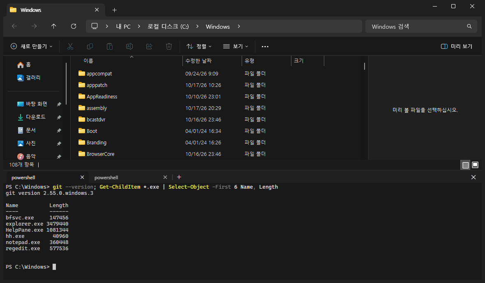

# Sill: a terminal panel for Windows File Explorer

[](https://github.com/2j2h5/winsill/releases/latest)
[](LICENSE)


Sill adds an integrated terminal to the bottom of File Explorer on Windows 11 and Windows 10, like the terminal panel in KDE Dolphin. Open PowerShell, Command Prompt (cmd) or Git Bash in the folder you are looking at, and File Explorer and the terminal follow each other's current folder.



Sill extends File Explorer itself. It is not a replacement file manager. The panel and the folder window stay in sync:

- When you go to another folder in File Explorer, the terminal runs `cd` to follow, but only while the shell is waiting at its prompt.
- When you `cd` in the terminal, File Explorer goes to that folder.

## Features

- **Terminal inside File Explorer:** a panel at the bottom of every File Explorer window. `` Ctrl+` `` opens and closes it, like the terminal in VS Code.
- **Two-way folder sync:** File Explorer and the shell stay in the same folder. Sill never types into a running program such as Claude Code or `vim`.
- **Terminal tabs:** several terminals per window, with VS Code keys (`` Ctrl+Shift+` ``, `Ctrl+PageUp`/`Ctrl+PageDown`).
- **Your shell:** PowerShell 7, Windows PowerShell, cmd, Git Bash, or any command line.
- **"Open in Sill"** on the right-click menu of a folder background.
- **Light and dark themes** that follow Windows.
- **No administrator rights:** per-user install and uninstall, registered under HKCU only.

## Requirements

- Windows 10 version 1903 or later, or Windows 11
- [WebView2 Runtime](https://developer.microsoft.com/microsoft-edge/webview2/). Windows 11 already has it.

Sill has only been tested on Windows 11 (build 26300). Each terminal uses about 86 MB of memory (PowerShell, including its WebView2 share).

## Install

1. Download `Sill-Setup-<version>.exe` from [Releases](https://github.com/2j2h5/winsill/releases) and run it. You don't need administrator rights. Sill is installed for the current user in `%LOCALAPPDATA%\Programs\Sill`.
2. The installer is not code-signed, so SmartScreen may show "Windows protected your PC". Click **More info**, then **Run anyway**.
3. Open a new File Explorer window and press `` Ctrl+` ``.

**Update:** run the setup of the newer version. If File Explorer had the panel loaded, restart File Explorer or sign out to use the new version. Your settings and panel height are kept.

**Uninstall:** in Settings > Apps, find Sill and choose Uninstall. This also deletes `%LOCALAPPDATA%\Sill` (logs, settings, WebView2 data). Files that are still in use are deleted at your next sign-in.

## Usage

### Keys

| Key | Action |
|---|---|
| `` Ctrl+` `` | Open the panel, focus it, or close it (in a File Explorer window) |
| `` Ctrl+Shift+` `` | New terminal |
| `Ctrl+PageUp` / `Ctrl+PageDown` | Previous / next terminal (wraps around) |
| `Ctrl+,` | Open `settings.json` in Notepad |
| `Ctrl+Up` / `Ctrl+Down` | Scroll to the previous / next command |
| `Ctrl+Home` / `Ctrl+End` | Scroll to the top / bottom |
| `Ctrl+Alt+PageUp` / `Ctrl+Alt+PageDown` | Scroll one line |
| `Shift+PageUp` / `Shift+PageDown` | Scroll one page |
| `Ctrl+C` | Copy if text is selected, otherwise send `^C` |
| `Ctrl+V` | Paste |
| `Ctrl+click` | Open a link in your default browser (http and https only) |

Sill handles these keys itself and doesn't send them to the shell (except `^C`). `` Ctrl+` `` and `` Ctrl+Shift+` `` work while a File Explorer window is in the foreground.

### Terminal tabs

- **+** (or `` Ctrl+Shift+` ``) opens a new terminal in the folder File Explorer is showing.
- Close a tab with its **×** or a middle click. Closing the last tab closes the panel.
- `exit` closes the tab. If the shell ends with a non-zero exit code, the tab stays open and shows the code. Press any key to restart it.
- The tab title is the title the running program sets, or the shell name.

### Context menu

Right-click an empty area of a folder and choose **Open in Sill**. On Windows 11 it is under **Show more options**. On the desktop, Sill opens that folder in a new File Explorer window with the panel.

### Folder sync

- File Explorer → terminal: Sill types `cd` only while the shell is waiting at the prompt. If you are typing a command or a program is running (for example Claude Code or `vim`), Sill skips the change and doesn't catch up later. It never sends input to a running program. Once you start typing at the prompt, the line counts as in use until you press Enter or Ctrl+C, even if you delete what you typed.
- Terminal → File Explorer: when the shell's folder changes, File Explorer follows.
- With several terminals, only the visible one is kept in sync. Switching tabs doesn't move File Explorer.
- In PowerShell and Git Bash the `cd` from Sill doesn't show up in the terminal or in your command history. In cmd it is typed as a normal command. cmd can't `cd` to a UNC path, so those changes are skipped.

### Settings

`%LOCALAPPDATA%\Sill\settings.json` (press `Ctrl+,` to open it):

```json
{ "shell": "pwsh" }
```

| `shell` | Runs |
|---|---|
| `""` or no file | `pwsh` if it is on PATH, otherwise Windows PowerShell |
| `powershell` | Windows PowerShell 5.1 |
| `pwsh` | PowerShell 7 |
| `cmd` | Command Prompt |
| `gitbash` | Git Bash |
| anything else | That command line, as is (folder sync needs one of the shells above) |

A change applies to the next terminal you open.

### Appearance

The panel follows the Windows app mode (light or dark) under Settings > Personalization > Colors.

## Troubleshooting

- **File Explorer keeps crashing:** press Win+R and run `%LOCALAPPDATA%\Programs\Sill\unins000.exe`. This works without File Explorer.
- **Setup says the path contains "#":** .NET Framework can't load the panel from such a folder, so Sill can't be installed for a user whose profile path contains `#`.
- **Smart App Control** blocks unsigned programs. On a PC where it is turned on, the setup won't run.
- **The panel says WebView2 is missing:** install the WebView2 Runtime and open the panel again.
- **The panel stays gray:** delete `%LOCALAPPDATA%\Sill\WebView2` and open the panel again.
- **The "Open in Sill" icon looks old after an update:** Windows caches menu icons. It refreshes eventually, or after you clear the icon cache.
- **Logs:** `%LOCALAPPDATA%\Sill\band.log` (panel), `host.log` (shell sessions), `keys.log` (shortcut keys). Each log is limited to about 2 MB.

## How it works

```
[explorer.exe]
  └ Sill.Band.dll (C#, COM Explorer Bar)
      └ WebView2 + xterm.js        draws the terminal and takes keyboard input
            ⇅ named pipe
[sill-host.exe]  one per terminal
  └ ConPTY → PowerShell / cmd / Git Bash
[sill-host.exe keys]  one per sign-in, shortcut keys
```

The code inside File Explorer is kept small, because an exception there brings down `explorer.exe`. Shells run in `sill-host.exe`. The shell integration reports the prompt state with OSC 133 and the current folder with OSC 9;9. Sill uses these to decide when it is safe to `cd`. Each terminal gets a random value that only its shell integration knows. Sill ignores these sequences when they don't carry it, so output from a program can't make Sill type `cd` or move File Explorer.

## Build from source

You don't need the .NET SDK. The build uses the C# compiler that comes with Windows (.NET Framework 4.8).

```powershell
powershell -ExecutionPolicy Bypass -File .\build.ps1             # bin\ (runs the unit tests first; closes File Explorer folder windows that hold the DLL)
powershell -ExecutionPolicy Bypass -File .\tools\register.ps1    # register bin\ for the current user
powershell -ExecutionPolicy Bypass -File .\tools\host-check.ps1  # sill-host test without File Explorer
powershell -ExecutionPolicy Bypass -File .\tools\package.ps1     # dist\Sill-Setup-<version>.exe (downloads Inno Setup into deps\)
powershell -ExecutionPolicy Bypass -File .\tools\unregister.ps1  # remove the registration
```

GitHub Actions runs the build, the shell tests and the installer build on every push to main.

## License

[MIT](LICENSE). Third-party licenses (xterm.js, WebView2 SDK) are in [THIRD-PARTY-NOTICES.txt](THIRD-PARTY-NOTICES.txt).
